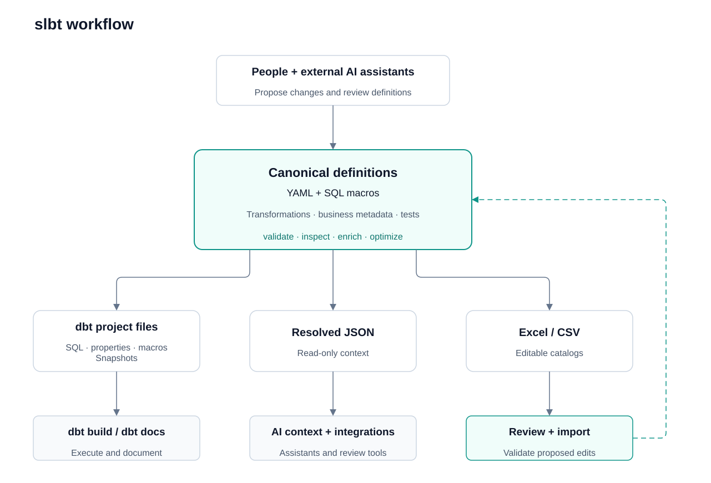

<p align="center">
  <picture>
    <source media="(prefers-color-scheme: dark)" srcset="docs/assets/slbt-logo-dark.svg">
    
  </picture>
</p>

<h1 align="center">slbt — Semantic Layer Build Tool</h1>

<p align="center">
  <a href="LICENSE"></a>
  <a href="pyproject.toml"></a>
  <a href="https://github.com/billybillysss/slbt/actions/workflows/ci.yml"></a>
  <a href="docs/index.md"></a>
</p>

<p align="center">
  <a href="docs/getting-started.md">Get started</a> · <a href="docs/index.md">Documentation</a> · <a href="docs/guides/ai-assisted-workflow.md">AI-assisted workflow</a> · <a href="examples/jaffle_shop/README.md">Jaffle Shop demo</a> · <a href="CONTRIBUTING.md">Contributing</a>
</p>

**Unify transformation logic and business meaning. Compile to dbt, document your
models, export structured context for AI, and inspect and optimize SQL.**

slbt keeps transformations, business definitions and tests in YAML. Its JSON
catalogs combine SQL, descriptions, types and dependencies so external AI assistants
can generate downstream logic consistent with your definitions, rather than infer
business meaning from SQL alone.



Excel supports models, sources, macros, defaults and classifications; CSV supports
models and sources.

slbt is an **offline build tool for transformation semantics**, not a metrics
query service or a replacement for dbt's execution engine. dbt handles database
connections, materializations, snapshots and test execution. slbt exports
documentation as dbt properties for `dbt docs`; it does not host a documentation site.

## Why keep business meaning with transformation logic?

SQL defines calculations; consumers also need their grain, units, inclusion rules
and intended use. A payment total is not necessarily net revenue, and distinct
order counts per payment method cannot necessarily be summed across methods.

Generate dbt artifacts and structured context from those definitions so people
and external AI assistants can review implementation and intent together.

## Keep AI-assisted logic consistent and maintainable

AI assistants can produce plausible but different implementations of the same
business request. Differences in filters, joins, null handling or aggregation grain
can create conflicting business definitions across models.

Reuse accepted rules in downstream models:

```text
AI proposes logic
       ↓
People review definitions, inspect SQL and run tests
       ↓
Accepted logic becomes canonical YAML
       ↓
Downstream models reference approved models
       ↓
Changes are reviewed, tested and regenerated
```

Assistants may interpret “customer lifetime value” as all payments, completed-order
payments or payments minus refunds. Reference an approved customer-value model to
reuse its calculation, and make different business definitions explicit.

With slbt, you can:

- Reference existing models and share supported macros
  instead of copying calculations.
- Review canonical YAML diffs and inspect supported
  expanded upstream SQL, including selected columns.
- Update canonical definitions and regenerate dbt
  artifacts and catalogs instead of editing outputs individually.
- Export expressions, descriptions, types, logical column
  lineage and dependencies for subsequent work.

Reuse reviewed definitions to keep calculations consistent. AI output can still
vary. Exported context cannot force an assistant to reuse a model, prevent every
conflicting definition or prove business correctness. Offline validation, human
review and executed dbt tests serve different purposes; none replaces the others.

## Why add slbt to dbt?

dbt already supports descriptions, tests, metadata, reusable models and
machine-readable artifacts. slbt adds an optional authoring and review layer;
documenting dbt or using AI with it does not require slbt.

Choose slbt when you want to:

- Author transformation expressions and their metadata together in YAML.
- Generate dbt SQL and properties from those canonical definitions.
- Inspect supported upstream transformations offline and preview logical
  optimization.
- Review supported definitions through editable Excel/CSV catalogs.
- Export scoped, resolved context for external assistants and integrations.

slbt adds a format and compilation step. You may not need it if handwritten dbt SQL,
properties and existing tooling meet your needs.

## How does this differ from dbt Semantic Layer?

slbt focuses on **defining and reviewing transformations before execution**. dbt
Semantic Layer, powered by MetricFlow, focuses on **querying reusable metrics
across dimensions**, using declared entities, aggregation rules and supported
join paths.

| Need | Better fit |
| --- | --- |
| Author transformations with associated descriptions, types and tests; generate dbt artifacts | slbt |
| Inspect supported selected-column upstream SQL offline; review logical rewrites | slbt |
| Define reusable metrics and dynamically query them across supported dimensions and joins | dbt Semantic Layer / MetricFlow |
| Serve governed metric queries through managed APIs and downstream integrations | dbt Semantic Layer |

Both can carry business meaning. dbt supports semantic annotations in model YAML;
MetricFlow supports local development and SQL generation. The managed service and
APIs are separate components.

**You do not need another semantic layer simply because you use slbt.** Add a
metric-query layer when consumers need reusable aggregation rules, dimensional
queries and governed metric access—not just defined transformation outputs.

Some projects may benefit from both, but slbt generates ordinary dbt artifacts,
**not MetricFlow semantic models or metric definitions**. Using both requires
separately maintained metric configuration and integration testing.

See dbt's [semantic model specification](https://docs.getdbt.com/docs/build/semantic-models)
and [Semantic Layer architecture](https://docs.getdbt.com/docs/use-dbt-semantic-layer/sl-architecture).

## Features

| Feature | Description |
| --- | --- |
| **YAML transformations and metadata** | Keep transformations, descriptions, types, tests and configuration together in [YAML](docs/reference/model-specification.md). |
| **SQL and column inspection** | [Inspect selected columns](#inspect-generate-optimized-sql-for-selected-columns) as optimized, expanded upstream SQL and an offline logical plan—without executing queries or changing files. |
| **JSON catalog export** | [Export versioned JSON](docs/reference/catalogs.md#resolved-json) containing SQL, metadata, dependencies and macro-expansion status for external assistants and integrations. |
| **dbt artifact generation** | Generate models, sources, properties, macros and snapshots. [Use alongside existing dbt models](docs/guides/existing-dbt-project.md); use dbt to execute transformations, run tests and build documentation. |
| **SQL optimization** | [Optimize canonical YAML](#optimize-simplify-and-rewrite-canonical-yaml): preview logical rewrites, review changes in Git and preserve declared output interfaces and metadata. |
| **dbt tests, constraints and contracts** | Define [data tests, constraints and contracts](docs/reference/model-specification.md#structured-transformations) with the logic they describe; dbt and the adapter handle execution and enforcement. |
| **Excel/CSV catalog editing** | [Review and edit Excel/CSV catalogs](docs/guides/catalog-round-trip.md), then validate changes before importing them into canonical definitions. |
| **Macros and configuration defaults** | Share [macros](docs/reference/model-specification.md#macros), [configuration defaults and layer/domain classifications](docs/reference/configuration.md#defaults-and-classifications). |

[AI-assisted authoring](docs/guides/ai-assisted-workflow.md) uses external assistants;
there is no built-in LLM service. JSON is read-only context, not an import format.
Logical optimization does not guarantee faster warehouse execution.

<details>
<summary>Additional features</summary>

- **Structured or explicit SQL:** author joins, filters and aggregations as
  [structured transformations](docs/reference/model-specification.md#structured-transformations),
  or use [raw SQL](docs/reference/model-specification.md#raw-sql-transformations)
  for CTEs, set operations and subqueries.
- **Offline validation:** [validate the project](docs/reference/cli.md#commands-and-write-boundaries)
  without a database, rejecting unsupported fields, duplicate YAML keys and invalid
  transformation definitions before export.
- **Metadata enrichment:** [fill missing types and descriptions](docs/reference/model-specification.md#enrichment)
  from known lineage without overwriting explicit metadata or guessing unresolved values.
- **Scoped outputs:** configure [named catalogs and resource selections](docs/reference/configuration.md#paths-and-catalog-selection),
  or limit dbt exports to a folder with `--subpath`; this does not automatically
  include upstream dependencies.
- **Preview and output management:** [use dry-run previews](docs/reference/cli.md#preview-before-writing)
  before writes. Stale-output deletion requires explicit `--prune`, which can also
  delete handwritten files placed in managed scope.
- **Project scaffolding and diagnostics:** start with `slbt init` and report the
  installed version with `slbt --version`; see the [CLI reference](docs/reference/cli.md).

</details>

## Quickstart

Requires Python 3.11+, [uv](https://docs.astral.sh/uv/) and Git. Install from source;
these instructions do not depend on a published PyPI package.

```sh
git clone https://github.com/billybillysss/slbt.git
cd slbt
uv sync --locked
uv run slbt --project-dir examples/jaffle_shop validate
uv run slbt --project-dir examples/jaffle_shop inspect gld_customers --columns customer_lifetime_value
uv run slbt --project-dir examples/jaffle_shop export dbt
uv run slbt --project-dir examples/jaffle_shop export catalog --format json
```

Validation reports `Validated 21 models and 3 source tables offline`. Inspect
prints optimized, expanded SQL without changing files. Exports populate generated
subfolders of `examples/jaffle_shop/dbt/` and create
`examples/jaffle_shop/catalog/catalog.json`.
Installing dependencies needs network access; these slbt commands need no database
or warehouse credentials.

To run the local DuckDB demo with the same dbt project:

```sh
uv run dbt build --project-dir examples/jaffle_shop/dbt --profiles-dir examples/jaffle_shop/dbt
```

It builds bundled seeds, models, a customer snapshot and data tests. See the
[walkthrough](examples/jaffle_shop/README.md) for business rules, expected results,
catalog editing and optimization cases.

## Example: YAML, dbt SQL and JSON

This is the real [payment-method model](examples/jaffle_shop/models/gld/payment_method_summary.yml).
Payment counts include zero-value payments; `paid_order_count` counts distinct
order IDs, not payment rows. Silver has already converted cents to currency units.

```yaml
version: 1
layer: gold
domain: sales
tables:
  - name: gld_payment_method_summary
    description: Payment-method usage, including zero-value payments.
    config:
      materialized: view
      meta:
        owner: payments
    output:
      from:
        ref: slv_payments
        alias: p
      group_by:
        - p.payment_method
      columns:
        payment_method:
          expression: p.payment_method
          data_type: varchar
          data_tests:
            - unique
            - not_null
        payment_count:
          expression: COUNT(*)
          data_type: bigint
        paid_order_count:
          expression: COUNT(DISTINCT p.order_id)
          data_type: bigint
        payment_total:
          expression: CAST(SUM(p.amount) AS DECIMAL(12, 2))
          data_type: decimal(12, 2)
```

**Generated dbt SQL** (`dbt/models/gld/gld_payment_method_summary.sql`):

```sql
{{
  config({
    'materialized': 'view',
    'meta': {
      'owner': 'payments',
      'domain': 'sales'
    }
  })
}}

SELECT
  p.payment_method AS "payment_method",
  COUNT(*) AS "payment_count",
  COUNT(DISTINCT p.order_id) AS "paid_order_count",
  CAST(SUM(p.amount) AS DECIMAL(12, 2)) AS "payment_total"
FROM {{ ref('slv_payments') }} AS "p"
GROUP BY
  p.payment_method
```

The export also emits descriptions, column types and tests as dbt properties.
**Resolved JSON** includes SQL, column expressions and lineage, metadata,
dependencies and macro-expansion status.
Selected fields from the same model in `catalog.json`:

```json
{
  "format": "slbt.catalog",
  "format_version": 1,
  "representation": "resolved",
  "models": [
    {
      "name": "gld_payment_method_summary",
      "description": "Payment-method usage, including zero-value payments.",
      "output": {
        "sql": "SELECT p.payment_method AS \"payment_method\", COUNT(*) AS \"payment_count\", COUNT(DISTINCT p.order_id) AS \"paid_order_count\", CAST(SUM(p.amount) AS DECIMAL(12, 2)) AS \"payment_total\" FROM \"ref\".\"slv_payments\" AS \"p\" GROUP BY p.payment_method",
        "columns": [
          {
            "name": "payment_method",
            "data_type": "varchar",
            "data_tests": ["unique", "not_null"],
            "expression": "p.payment_method",
            "lineage": {
              "status": "resolved",
              "upstream_columns": [{"relation": "ref.slv_payments", "column": "payment_method"}]
            }
          },
          {
            "name": "payment_count",
            "data_type": "bigint",
            "expression": "COUNT(*)",
            "lineage": {"status": "resolved", "upstream_columns": []}
          },
          {
            "name": "paid_order_count",
            "data_type": "bigint",
            "expression": "COUNT(DISTINCT p.order_id)",
            "lineage": {
              "status": "resolved",
              "upstream_columns": [{"relation": "ref.slv_payments", "column": "order_id"}]
            }
          },
          {
            "name": "payment_total",
            "data_type": "decimal(12, 2)",
            "expression": "CAST(SUM(p.amount) AS DECIMAL(12, 2))",
            "lineage": {
              "status": "resolved",
              "upstream_columns": [{"relation": "ref.slv_payments", "column": "amount"}]
            }
          }
        ]
      },
      "dependencies": [
        {"relation": "ref.slv_payments", "included": true}
      ],
      "expansion": {"status": "expanded", "macro_refs": []}
    }
  ]
}
```

JSON is **read-only context**, not an import format or a fully inlined query.
Use `inspect` to expand loaded upstream models. The
[JSON reference](docs/reference/catalogs.md#resolved-json) explains the versioned
envelope and deferred runtime macros. README examples are checked against exports
in the test suite.

## Inspect: generate optimized SQL for selected columns

To trace `payment_total`, use `inspect`. It expands upstream logic and
**generates optimized SQL for the selected columns**, pruning unused projections
and merging eligible intermediate steps. Operations needed to preserve results,
including joins, grouping and ranking, remain intact. No source files change.

```sh
uv run slbt --project-dir examples/jaffle_shop inspect gld_payment_method_summary --columns payment_total
```

SQL output, with CLI headers omitted:

```sql
SELECT
  a.payment_total AS payment_total
FROM (
  SELECT
    CAST(SUM(CAST(ROUND(p.amount / 100.0, 2) AS DECIMAL(12, 2))) AS DECIMAL(12, 2)) AS payment_total
  FROM source.jaffle_shop.payments AS p
  GROUP BY
    p.payment_method
) AS a;
```

The query shows source payments, conversion from cents, rounding and aggregation.
It retains payment-method grouping even though only the total is selected, and
omits unrelated output columns.

Generated relation aliases follow canonical optimization's `a, b, c, …, z, aa, ab, …`
rule, skipping collisions. Here `a` is generated; authored `p` and output name
`payment_total` are preserved. SQL and logical-plan views use the same names.

For a logical plan instead of SQL:

```sh
uv run slbt --project-dir examples/jaffle_shop inspect gld_payment_method_summary --columns payment_total --view plan
```

Both commands are **offline and read-only**. Logical source names still need
physical bindings before execution; the plan is not a warehouse EXPLAIN plan.
Inspection optimizes by default. Add `--optimize false` to see expanded SQL
without optimization.

## Optimize: simplify and rewrite canonical YAML

Unlike `inspect`, **`optimize` rewrites canonical YAML** rather than producing a
standalone SQL file.
It parses and simplifies transformations, including SQL in steps and `output.sql`,
then reconstructs structured YAML where supported. Other queries remain SQL within
YAML. It does not import arbitrary `.sql` files.

The bundled [lifetime-value teaching model](examples/jaffle_shop/models/gld/optimization/customer_lifetime_value.yml)
has two pass-through steps and an unused status projection. Preview their removal:

```sh
uv run slbt --project-dir examples/jaffle_shop optimize -s gld_customer_lifetime_value --preserve-macro false --dry-run
```

`--preserve-macro false` expands static macros, including `round_money`, before
optimization. **The dry run reports proposed file actions, not a YAML or SQL diff.**
The excerpts show the teaching model's actual rewrite.

<details>
<summary>Before and after YAML</summary>

Model-level name, description and configuration are omitted here; column metadata
is shown.

**Before** — two intermediate steps:

```yaml
steps:
  projected_orders:
    from:
      ref: gld_orders
      alias: o
    columns:
      customer_id: o.customer_id
      amount: o.amount
      unused_status: o.status
  normalized_orders:
    from:
      step: projected_orders
      alias: p
    columns:
      customer_id: p.customer_id
      amount: p.amount + 0
output:
  from:
    step: normalized_orders
    alias: n
  group_by:
    - n.customer_id
  columns:
    customer_id:
      expression: n.customer_id
      data_type: bigint
      data_tests:
        - unique
        - not_null
    lifetime_value:
      expression: CAST(round_money(SUM(n.amount)) AS DECIMAL(12, 2))
      data_type: decimal(12, 2)
      description: Total payments for customers with orders; unlike gld_customers, customers without orders are absent.
```

**After** — aggregate directly from `gld_orders`, with no local steps:

```yaml
output:
  from:
    ref: gld_orders
    alias: o
  group_by:
    - o.customer_id
  columns:
    customer_id:
      expression: o.customer_id
      data_type: bigint
      data_tests:
        - unique
        - not_null
    lifetime_value:
      expression: CAST(ROUND(SUM(o.amount + 0), 2) AS DECIMAL(12, 2))
      data_type: decimal(12, 2)
      description: Total payments for customers with orders; unlike gld_customers, customers without orders are absent.
```

</details>

Final column names, order, types, descriptions and tests are preserved. The rewrite
removes redundant query layers and an unused projection; `amount + 0` remains.
Optimization does not fold every expression.

To apply the rewrite, use a review branch or a separate project copy:

```sh
uv run slbt --project-dir examples/jaffle_shop optimize -s gld_customer_lifetime_value --preserve-macro false
git diff -- examples/jaffle_shop/models/gld/optimization/customer_lifetime_value.yml
uv run slbt --project-dir examples/jaffle_shop validate
uv run slbt --project-dir examples/jaffle_shop export dbt
```

Re-run dbt data tests before deployment and refresh other generated artifacts as
needed. Logical simplification does **not** guarantee faster warehouse execution.
See the [inspection and optimization guide](docs/guides/inspection-and-optimization.md)
for more examples and limitations.

## Safety and maturity

slbt is currently **0.2.0**. Evaluate it on a version-controlled project before
adopting it in production; passing offline validation does not prove business
correctness or adapter compatibility.

- `inspect` and `validate` are read-only. Preview mutating operations with `--dry-run`.
- `optimize`, `enrich`, `import` and `sync-classifications` write canonical files
  unless previewed. Review a Git diff before exporting or deploying.
- Exports overwrite managed outputs. `--prune` can delete files in managed scope,
  including handwritten files placed there. Keep generated directories dedicated.
- Runtime-dependent macros export to dbt, but cannot be inspected offline;
  optimization skips those models unchanged and reports why.
- Logical plans are not warehouse EXPLAIN plans. Multi-file writes are not
  crash-safe transactions; do not run concurrent writers against one project.

Read the [production checklist](docs/guides/production-workflow.md),
[compatibility policy](docs/compatibility.md) and [security policy](SECURITY.md).

## Develop and contribute

```sh
uv run pytest
uv build
```

See [Contributing](CONTRIBUTING.md), [architecture](docs/development/architecture.md),
[testing](docs/development/testing.md), [release checks](docs/development/releasing.md)
and the [changelog](CHANGELOG.md). Start at the [documentation index](docs/index.md)
for configuration, CLI reference and troubleshooting.

## License

slbt is [MIT licensed](LICENSE). Bundled Jaffle Shop seed data retains its
[Apache 2.0 license and provenance](examples/jaffle_shop/dbt/seeds/README.md).
